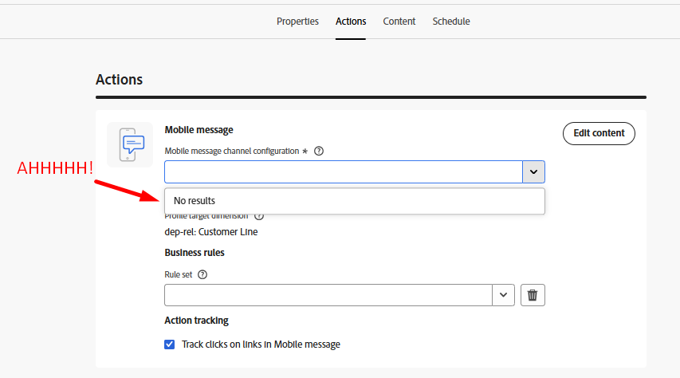

# Filtra le righe

## Obiettivo

Nei passaggi successivi escluderai tutte le righe di cui non è consentito il targeting con un messaggio SMS a causa della rinuncia a livello di riga.  In questo caso non puoi fare affidamento sul consenso al profilo, perché si tratta di un target a livello di linea.

## Configurare l’attività di suddivisione

1. Fai clic sull&#39;icona **+** nella transizione inferiore dell&#39;attività Fork e seleziona l&#39;attività **Dividi** nel popup.

   

2. Nella barra a destra, aggiorna l&#39;etichetta in modo che indichi quanto segue: `Filter out opt'd out lines`

   

3. Nella barra a destra espandi la sezione **Sottoinsieme** del segmento predefinito e fai clic sul pulsante **Crea filtro**

   

4. Aggiungi una condizione per assicurarti di rimuovere tutte le righe cliente che hanno rinunciato alla messaggistica SMS, quindi fai clic su **Conferma**.

   

   >[!NOTE]
   >
   >Devi capire come creare la condizione, ma il risultato finale corrisponde alla schermata precedente.  Ce l&#39;hai!

5. Fare clic sul pulsante Salva in alto a destra per salvare i dati.  L&#39;area di lavoro è simile ora\...

## Aggiungi dimensione di modifica

1. Nell&#39;area di lavoro del flusso di lavoro fare clic sull&#39;icona **+** dopo la condizione di suddivisione aggiunta e selezionare l&#39;attività **Modifica dimensione**

   

2. Aggiorna le proprietà della dimensione di modifica come descritto di seguito e fai clic su **Conferma**:
Etichetta: `Convert Line to Account`
Nuova dimensione di destinazione: `dep-rel: Customer Account`

   

   

## Aggiungere l’attività SMS

1. Fai clic sull&#39;icona **+** dopo la dimensione di modifica aggiunta e seleziona l&#39;**Attività messaggio mobile**

   

   

2. Nella barra a destra, fai clic sul pulsante **Modifica messaggio mobile** per avviare la configurazione del messaggio SMS

   

3. Nella barra di navigazione in alto, fai clic sulla voce di menu Azioni, quindi seleziona il canale creato in precedenza dal menu a discesa Configurazione messaggio mobile.

>[!CAUTION]
>
>Oh no 🫨!  Perché non ottieni alcun risultato?  Non hai già configurato il tuo canale SMS?  Il prodotto è rotto?
>
>VAFFANCULO!!!!!!!!!

## Momento di abbandono

La configurazione del canale per SMS era già stata configurata in precedenza e al momento è così...

**Di seguito è riportato il testo:**

- Consegna un messaggio per dimensione di destinazione (ad esempio Conto cliente) sul numero di record correlati trovati nella dimensione secondaria (ad esempio Linea cliente)
- Esegui ogni consegna SMS utilizzando il numero di telefono cellulare presente nella dimensione secondaria (ad esempio, Linea cliente)

Questa capacità unica di inviare molti messaggi a un profilo è una delle caratteristiche principali delle Campagne orchestrate, che lo rende diverso dai Percorsi. Tuttavia, la transizione che porta all’attività Mobile Message è impostata su Account cliente. Questo ti consente di unirlo nuovamente al Real-Time Customer Profile al momento dell’invio, in modo che le informazioni di consegna e tracciamento dei messaggi vengano attribuite a un profilo.

Come si fa a far funzionare tutto questo? Modificare la destinazione per l&#39;esecuzione del messaggio in modo che corrisponda alla configurazione del canale 😀

## Modificare Target e completare la configurazione dei messaggi SMS

1. Fai clic sul pulsante Indietro nella schermata di modifica SMS

   

2. Con l&#39;attività di messaggistica mobile selezionata, nella barra a destra modifica prima l&#39;opzione di destinazione predefinita di un messaggio per profilo in **Un messaggio per dimensione secondaria** e quindi fai clic di nuovo in **Modifica messaggio mobile**

   

3. Nella barra di navigazione in alto, fai clic sulla voce di menu **Azioni**, quindi seleziona il canale creato in precedenza dal menu a discesa Configurazione messaggio mobile.

   

## Riassunto

Hai filtrato tutte le righe di cui non era consentito il targeting con un messaggio SMS a causa della rinuncia, modificato la dimensione da riga a account e alla fine hai configurato correttamente l’attività SMS per coloro a cui era consentito il targeting.
Speriamo che tu abbia anche imparato una cosa molto importante: **la destinazione deve corrispondere alla configurazione del canale che desideri utilizzare**
